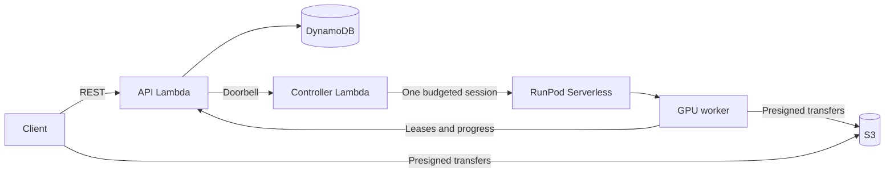

# Gremlin

Gremlin replaces a character in a short clip with a person or animal from a reference photo.
It follows the driving clip's motion, timing, camera and scene, and returns a silent MP4, a 512 x 512 animated WebP sticker and a JPEG poster.

The [public demo](https://demo.albmth.dev) takes a photo and a clip, shows progress, and opens a private preview.
The HTTP API also accepts explicit subject points, a 3 to 5 second interval and a prompt.

## How it works



- **API** authenticates clients, validates inputs and owns the job lifecycle.
  Clients and workers transfer media directly through short-lived storage URLs.
- **Controller** reserves the session cost before submitting GPU work, reconciles provider charges and sweeps expired data.
  The same state machine handles retries, cancellation, lost responses and expired leases.
- **Worker** tracks the subject with SAM and runs [SCAIL-2](https://github.com/zai-org/SCAIL-2) on ComfyUI with pinned recipes and weights.
  It restores static overlays from the original clip before encoding the result.
- **Demo** is a standalone client with automatic subject selection, live progress and private previews that delete on close.

The sampled cold-start time fell after routine submissions stopped replacing RunPod's retained container.
The [engine guide](docs/engine.md) records warm and cold timings, GPU qualifications and known quality limits.

## Run locally

Install Python 3.12, [uv](https://docs.astral.sh/uv/), Docker and FFmpeg with libx264.
The browser tests also use Google Chrome.
Start Docker, then run:

```sh
uv sync --locked
./tools/check.sh
./web/dev.sh
```

Open the demo at http://127.0.0.1:8080, or follow the [local API quickstart](docs/integration.md#run-gremlin-locally).
The local loop uses DynamoDB Local, MinIO and a simulated GPU worker.
Tests that use private fixture media skip when their inputs are absent.
Maintainers can enable the repository's pre-commit hook with `git config --local core.hooksPath .githooks`.

## Repository guide

| Path | What lives there |
| --- | --- |
| `control/` | FastAPI service, controller, DynamoDB job state and retention |
| `worker/` | GPU image, ComfyUI graph, media pipeline and model pins |
| `web/` | Demo site and Playwright tests |
| `contract/` | Black-box tests against the real API, local storage and a simulated provider |
| `examples/` | Tested Python API client |
| `infra/` | CloudFormation, operator scripts and the demo's Cloudflare proxy |
| `tools/` | Development checks, fixture reviews and model release tooling |

- [API reference](docs/api.md) and [OpenAPI schema](docs/openapi.json)
- [Client integration](docs/integration.md) and [contract tests](contract/README.md)
- [Engine](docs/engine.md), [fixture review](docs/fixtures.md) and [model releases](docs/model-release.md)
- [Demo architecture](docs/web.md), [operations](docs/operations.md) and [privacy and retention](docs/privacy.md)
- [Architecture decisions](docs/adr/) and [open work](PLAN.md)

Quality was reviewed on two fixtures on the RTX 5090.
The local worker exercises transport and orchestration without running inference.

## Licensing

The Gremlin source is all rights reserved.
Third-party terms are in [worker notices](worker/notices/) and the [demo detector notice](web/gremlin_web/models/NOTICE).
