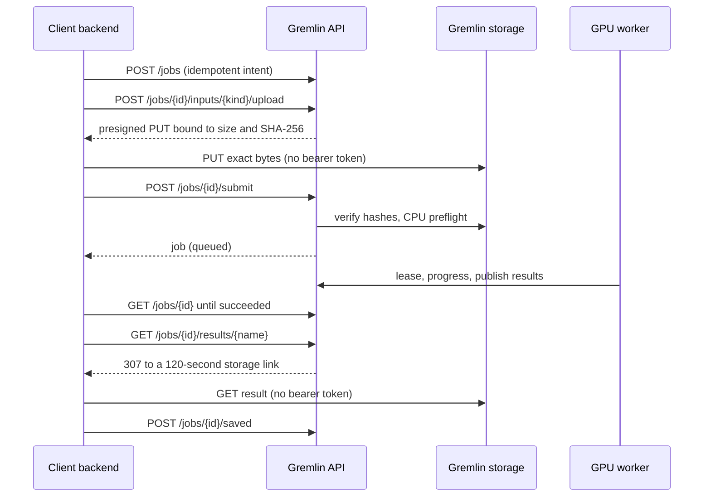

# Gremlin API reference (contract version 3)

This is the human reference for Gremlin's client API.
The machine-readable contract is [`openapi.json`](openapi.json), generated from the code and checked by a test, so the two cannot drift.
The [integration guide](integration.md) explains how to build a reliable client on top of these operations.
Every behavior below is exercised by the black-box suite in [`contract/`](../contract/README.md).

## Overview

A client asks Gremlin to replace one character in a short driving clip with the person in a reference image.
The flow is always the same:

1. `POST /api/imprint/jobs` with the SHA-256 of both normalized files, the selection points, the interval, the prompt and the tier.
2. For each input, `POST .../inputs/{kind}/upload`, then `PUT` the exact bytes to the returned storage link.
3. `POST .../submit`: Gremlin verifies the stored bytes, runs a CPU preflight and queues the job.
4. Poll `GET /api/imprint/jobs/{id}` until `state` is terminal.
5. On success, download each file through `GET .../results/{name}`, verify size and SHA-256, store it, then `POST .../saved`.



## Authentication and owner scope

Every route under `/api/imprint` requires `Authorization: Bearer <token>`.
The operator issues one token per client identity and configures only its SHA-256; there is no self-registration.
Use HTTPS outside localhost and never send the token to a storage URL.

A client identity is either direct or delegated:

| Kind | Scope of jobs, idempotency keys and the active-job slot | `X-Gremlin-Owner` header |
| --- | --- | --- |
| Direct | The client identity itself | Forbidden: 400 `CLIENT_OWNER_UNSUPPORTED` |
| Delegated | Each end user, identified by the client's opaque owner ID | Required on every call: 400 `CLIENT_OWNER_REQUIRED` |

A delegated client is a backend serving many end users, such as a consumer app.
The owner ID is 1 to 100 characters of `A-Z a-z 0-9 _ -`; use an internal opaque ID, never an email or name.
Gremlin trusts the delegated client to authenticate its users; it never accepts an owner ID from an end-user device.
A job of another owner or another client reads as 404 `IMPRINT_NOT_FOUND` on every route, so a job ID is never authorization.

`GET /health` and `GET /openapi.json` are public; health proves only that the API answers.

## Conventions

- Request and response bodies are JSON, except result files and the diagnostics ZIP.
- Times are Unix epoch seconds as numbers; job IDs are UUIDs.
- Unknown fields in request bodies are rejected with 422.
- `submit`, `saved` and `DELETE` take no body.
- Media bytes never pass through the API: they move through presigned storage links, and the API accepts at most 6 MB per request.
- Clients must ignore unknown response fields.

## Errors

Gremlin's own errors have one shape:

```json
{"detail": {"code": "IMPRINT_MEDIA_INVALID", "message": "Use a valid still reference and driving clip within media and trim limits.", "reason": "driving_too_short"}}
```

Branch on HTTP status and `detail.code`; `reason` refines three codes; `message` is for logs.
Request validation errors (422) use a list: `{"detail": [{"type": ..., "loc": [...], "msg": ...}]}`.
Unknown paths answer 404 `{"detail": "Not Found"}` and wrong methods 405.
Errors produced in front of the application (502, 504, a 429 or 503 without `detail.code`, a plain-text 500) are transient: retry with backoff.
Storage links answer with S3-style XML errors.

| Status | `detail.code` | Meaning | Client action |
| --- | --- | --- | --- |
| 400 | `CLIENT_OWNER_REQUIRED`, `CLIENT_OWNER_UNSUPPORTED` | Owner header missing for a delegated client, or sent by a direct one | Fix the client |
| 401 | `CLIENT_AUTH_REQUIRED`, `CLIENT_AUTH_INVALID` | Missing or unknown token | Fix configuration; alert |
| 404 | `IMPRINT_NOT_FOUND` | Unknown, pruned or another scope's job | See [recovery](integration.md#the-client-state-machine) |
| 404 | `IMPRINT_RESULT_UNAVAILABLE` | Result not downloadable now | Read the job |
| 404 | `IMPRINT_DIAGNOSTICS_UNAVAILABLE` | No retained diagnostics | Use `outcome` |
| 404 | `IMPRINT_DISABLED` | The operator disabled the service | Treat as an outage |
| 409 | `IMPRINT_INTENT_CHANGED` | Same idempotency key, different fields | Recover the original body |
| 409 | `IMPRINT_ACTIVE` | This scope already has an unfinished job | Finish, recover or cancel it |
| 409 | `IMPRINT_SEALED` | Upload link requested outside `uploading`, or after the admission deadline | Read the job |
| 409 | `IMPRINT_INPUT_REQUIRED` | Submit before both inputs are stored | Upload the missing input |
| 409 | `IMPRINT_STARTED` | Conditional cancel lost to a started worker | The job runs to its end |
| 410 | `IMPRINT_INTENT_EXPIRED` | The key's job was pruned; the key is retired forever | Keep the intent terminal |
| 413 | `IMPRINT_MEDIA_TOO_LARGE` | Declared input size over its limit | Reject the file locally |
| 422 | `IMPRINT_MEDIA_INVALID` | Preflight rejected the inputs; `reason` says why | Cancel; fix the media; new intent |
| 422 | `IMPRINT_HASH_MISMATCH` | Stored bytes differ from the declared hash | Upload the exact bytes again |
| 422 | `IMPRINT_ADMISSION_EXPIRED`, `IMPRINT_ADMISSION_TOO_LATE` | `admission_expires_at` in the past or more than 24 hours ahead | Fix the request |
| 429 | `IMPRINT_LIMIT` | Service-wide daily job limit; `Retry-After` header and `reason: daily_limit_reached` | Keep the intent uncreated; retry later |
| 503 | `IMPRINT_BUDGET_BLOCKED` | Admission closed by the operator; `reason` is `spending_unauthorized` or `endpoint_unconfigured` | Retry submit later or cancel |
| 503 | `IMPRINT_PREFLIGHT_UNAVAILABLE` | Preflight timed out; nothing was queued | Repeat submit with backoff |
| 503 | `IMPRINT_MODERATION_UNAVAILABLE` | Safety checks are unavailable or another request is checking this job | Retry with backoff, then read the job outcome; exhausted checks fail the job |

Preflight `reason` values: `reference_undecodable`, `reference_not_still`, `reference_too_large`, `driving_undecodable`, `driving_resolution`, `driving_frame_rate`, `driving_too_short`, `driving_timestamps`.

## Operations

All paths are under `/api/imprint`.

| Method and path | Purpose | Success |
| --- | --- | --- |
| `GET /capabilities` | Version, build, tiers, live admission status, limits, retention | 200 capabilities |
| `POST /jobs` | Create a job, or replay the job this key created | 200 job |
| `GET /jobs?state=&limit=` | This scope's unpruned jobs, newest first; `state` is a state or `active` | 200 `{"jobs": [...]}` |
| `GET /jobs/{id}` | The job's state, progress, outcome and manifest | 200 job |
| `POST /jobs/{id}/inputs/{reference\|driving}/upload` | A link that accepts exactly the declared bytes | 200 upload link |
| `POST /jobs/{id}/submit` | Verify inputs, preflight and queue | 200 job |
| `DELETE /jobs/{id}[?if_not_started=true]` | Cancel | 200 job |
| `POST /jobs/{id}/saved` | Results are durably stored by the client | 200 `{"acknowledged": true}` |
| `GET /jobs/{id}/results/{name}` | Download `result.mp4`, `result.webp` or `poster.jpg` | 307 to a storage link |
| `GET /jobs/{id}/diagnostics` | Sanitized diagnostic ZIP | 200 ZIP |

Every operation is safe to repeat with the same inputs.

### Capabilities

```json
{
  "contract_version": 3,
  "build": "f9a4c3d0c5b1...",
  "tiers": ["simple-motion", "complex-motion"],
  "admission": {
    "accepting": true,
    "dispatching": false,
    "reason_code": "dispatch_disabled",
    "retry_after_seconds": null,
    "daily_jobs_limit": 8,
    "daily_jobs_remaining": 7,
    "observed_at": 1792472875.3
  },
  "limits": {"duration_ms": [3000, 5000], "start_ms": [0, 60000], "prompt_chars": [20, 2000], "...": "..."},
  "outputs": {"fps": 16, "sticker_side_px": 512, "poster_max_side_px": 384, "max_bytes": {"...": "..."}},
  "retention": {"admission_seconds": 86400, "media_seconds": 259200, "...": "..."}
}
```

`accepting` means a create and submit would be admitted now.
`dispatching` means queued jobs are being started on a GPU.
`reason_code` names the first blocker, in this order:

| `reason_code` | `accepting` | Meaning |
| --- | --- | --- |
| `spending_unauthorized` | false | The operator has authorized no GPU spending; submit answers 503 |
| `endpoint_unconfigured` | false | No GPU endpoint is configured; submit answers 503 |
| `daily_limit_reached` | false | Creates answer 429 until `retry_after_seconds` passes |
| `dispatch_disabled` | true | Jobs are admitted and queue, but none start until the operator enables dispatch |
| `dispatch_held` | true | A GPU session ended in a way that needs operator review (never a single job's failure); queued jobs wait |
| `budget_exhausted` | true | The remaining budget cannot cover another GPU session; queued jobs wait |

Admission is a snapshot: GPU stock, provider health and other clients can still delay a queued job.
A queued job that never starts expires at its admission deadline with outcome `expired`.

### Create a job

| Field | Type and range | Meaning |
| --- | --- | --- |
| `idempotency_key` | 16 to 100 of `A-Z a-z 0-9 _ -` | The client's key for this intent, unique within its scope |
| `reference_sha256` | 64 lowercase hex | SHA-256 of the exact reference bytes |
| `driving_sha256` | 64 lowercase hex | SHA-256 of the exact driving clip bytes |
| `reference_point` | `{"x": 0..1, "y": 0..1}` | A point on the person in the upright reference image |
| `target_point` | `{"x": 0..1, "y": 0..1}` | A point on the character to replace, in the driving frame at `start_ms` as stored |
| `start_ms` | 0 to 60000, default 0 | Interval start in the driving clip |
| `duration_ms` | 3000 to 5000, required | Output length |
| `seed` | 0 to 4294967295, default 42 | Sampling seed |
| `prompt` | 20 to 2000 characters | Sent to the model unchanged; see [writing the prompt](integration.md#writing-the-prompt) |
| `tier` | `simple-motion` or `complex-motion` | The recipe; see [choosing the tier](integration.md#choosing-the-tier) |
| `admission_expires_at` | optional epoch seconds, at most 24 hours ahead | The latest time the job may start; default 24 hours after creation |

Points are normalized from the top-left corner.
A new job starts in `uploading` and uses one daily slot, even if later cancelled.
Replaying the same key with identical fields returns the existing job in whatever state it reached, before any active-job or limit check.
Any changed field, including the tier, seed or deadline, returns 409 `IMPRINT_INTENT_CHANGED`.
After the job record is pruned (30 days after it ends) the key answers 410 forever.

### Upload an input

Request `{"bytes": <exact size>}`; the response is:

```json
{"method": "PUT", "url": "https://<storage>/...&X-Amz-Signature=...", "headers": {"Content-Length": "370926", "x-amz-checksum-sha256": "<base64 SHA-256>"}, "expires_at": 1792473175.29}
```

Send exactly those bytes with exactly those headers and no `Authorization` header.
Storage refuses other bytes with 400 and another length, a missing header or an expired link with 403.
A link lasts 300 seconds; after any failure request a new one.
Resending identical bytes is harmless.
Limits: reference 10 MiB, driving clip 30 MiB.

### Submit

Submit checks both stored objects against the declared hashes, checks admission, then runs the CPU preflight (at most 8 seconds) before queueing.
When `capabilities.features` includes `safety_moderation`, that same child also samples the reference and selected driving interval, followed by managed prompt and visual checks with a 12-second deadline.
Media validation errors leave the job in `uploading`; safety refusals end it as `failed` with `failure_code: content_rejected`, without starting an attempt.
Unavailable safety services return `503 IMPRINT_MODERATION_UNAVAILABLE` and never queue unchecked work.
Input and output checks each have at most three durable attempts, so recovered input checks cannot consume the output allowance.
Concurrent requests share a fenced claim; accepted checks are reused for the immutable input or output, including lost-response recovery.
Exhausted checks fail with `failure_code: moderation_unavailable`; abandoned uploads still reach their original admission deadline, and abandoned worker attempts retain their lease expiry.
Repeating submit after the job left `uploading` returns the current job without repeating any check.
The preflight accepts a single-frame reference of at most 4,147,200 pixels and a GIF, MP4/MOV, Matroska, WebM or WebP driving clip with a decodable timestamped first frame, at most 1920 pixels per side and 1920 x 1080 pixels, at most 60 fps, covering `start_ms + duration_ms`.

### Cancel

`DELETE` ends any job not already `cancelled` or `expired`, including a succeeded one, and withdraws its media at once.
Cancelling a job a worker holds fences its publication and stops the GPU session asynchronously; the GPU time spent is not recovered.
With `?if_not_started=true` the cancel succeeds only while no worker has leased the job; otherwise it answers 409 `IMPRINT_STARTED` and changes nothing.
The two outcomes are decided atomically against the lease.

### Saved

After all three files are downloaded, verified and durably stored, `POST /saved` shortens Gremlin's media retention to at most 24 hours from now.
It never extends retention and answers `{"acknowledged": true}` in every state.
Omit it to keep the full 72-hour window.

### Results and diagnostics

`GET /results/{name}` answers 307 with `Cache-Control: no-store`, redirecting to a storage URL valid for 120 seconds.
Follow it without forwarding the bearer token; standard HTTP clients drop `Authorization` on a cross-host redirect.
It answers 404 `IMPRINT_RESULT_UNAVAILABLE` unless the job is `succeeded` and its media window is open.

`GET /diagnostics` serves a ZIP of at most 32 KiB containing only `diagnostics.json`: `schema_version` 1, the last `stage`, allowlisted numeric `timings` and, after a failure, `failure_code`.
It contains no prompt, media, hashes or exception text.
It is available for 7 days after the job ends, except after cancellation.

## The job object

```json
{
  "id": "22e8e10a-5f8d-4a6a-b943-65a22fc2f846",
  "state": "running",
  "tier": "complex-motion",
  "created_at": 1792472875.29,
  "updated_at": 1792472990.11,
  "admission_expires_at": null,
  "media_expires_at": null,
  "progress": {"stage": "running", "since": 1792472990.11, "queue_position": null},
  "execution": {"gpu_requested_at": 1792472890.04, "gpu": "NVIDIA GeForce RTX 5090", "gpu_seen_at": 1792472931.6, "started_at": 1792472962.18, "timings": {"engine_first_use": 1, "input_transfer_seconds": 0.4, "preparation_seconds": 1.9, "tracking_seconds": 14.2}},
  "outcome": null,
  "error": null,
  "result": null
}
```

The [OpenAPI document](openapi.json) has a complete succeeded example.

| Field | Present | Meaning |
| --- | --- | --- |
| `state` | Always | One of the states below |
| `admission_expires_at` | While `uploading` or `queued` | When the job expires unstarted |
| `media_expires_at` | While `succeeded` | When the results stop being downloadable |
| `progress` | While active | `stage` (the state), `since` (entry time) and, while queued, `queue_position` (unexpired queued jobs ahead) |
| `execution` | While first in the queue with a GPU requested, and from the moment a worker takes the job | The GPU serving it; see [execution](#execution) |
| `outcome` | Once ended | Immutable: `kind`, `at`, `attempt_started`, `failure_code`, `failure_reason` |
| `error` | After a failure | Human-readable text; branch on `outcome`, not on this |
| `result` | While results are downloadable | Versioned manifest of the three files |

Gremlin reports stages, not percentages or ETAs: GPU placement and model preparation time are not predictable enough to promise either.
Typical durations are in the [integration guide](integration.md#latency).

### Execution

`execution` follows the GPU session that serves the job, without provider identifiers.
A queued job has it only while it is first in the queue and Gremlin has requested a GPU session that has not taken other work; it stays after the job ends, until the record is pruned.

| Field | Meaning |
| --- | --- |
| `gpu_requested_at` | When Gremlin requested that session; a new value means the earlier request found no capacity and was replaced |
| `gpu` | The GPU model once known, for example `NVIDIA GeForce RTX 5090`: from the provider's worker list, which the controller reads about once a minute, or, when the session allowed only one GPU model, from the worker's own check of its GPU before it took the job; otherwise null |
| `gpu_seen_at` | When that model was first known; never later than `started_at` |
| `started_at` | When a worker took the job, or null |
| `timings` | The worker's measurements so far, updated at each stage: `input_transfer_seconds`, `preparation_seconds`, `tracking_seconds`, `generation_seconds`, `restoration_seconds`, `encoding_seconds`, `delivery_seconds`, `total_seconds`, `attempt_seconds`, `model_file_load_seconds` and `model_device_load_seconds` (parts of tracking and generation), and `engine_first_use` (1 on a worker's first job, 0 when warm) |

These are observations for display and support, not a schedule: a fast job can finish before the worker list is read, leaving `gpu` null.

### States

| State | Meaning |
| --- | --- |
| `uploading` | Created; waiting for both inputs and submit |
| `queued` | Admitted; waiting for a GPU |
| `preparing` | A worker leased the job: input download, resampling, subject tracking |
| `running` | Video diffusion |
| `finishing` | Static-overlay restoration, encoding, publication |
| `succeeded` | Results are published |
| `failed` | Safety checks or the attempt failed; Gremlin never regenerates it |
| `cancelled` | Cancelled by the client |
| `expired` | Never started before its deadline, or a succeeded job's media window ended |

### Outcome

`outcome` is set once, when the job first ends, and later expiry or cancellation never rewrites it.
It stays readable until the job record is pruned 30 days later.

| `kind` | Meaning | `attempt_started` |
| --- | --- | --- |
| `ready` | Results were published; a later `expired` or `cancelled` state keeps this outcome | true |
| `failed` | Safety checks or an attempt failed | true or false |
| `cancelled` | Cancelled before any result | true or false |
| `expired` | Never started before the admission deadline | false |

A failed job has one `failure_code`; `failure_reason` is set only for `input_rejected`:

| `failure_code` | Meaning | `failure_reason` |
| --- | --- | --- |
| `input_rejected` | The inputs cannot produce a result; found on the GPU after the CPU preflight passed. Resubmitting the same inputs fails the same way | `reference_subject_not_found`: nothing to segment at `reference_point`; `target_not_tracked`: the character at `target_point` is lost or fills the frame in some frame of the interval; `driving_scene_cut`: the interval contains a cut |
| `content_rejected` | The prompt, sampled input or sampled output did not pass safety policy; no result is published | null |
| `moderation_unavailable` | Managed checks exhausted their bounded recovery or the upload deadline; no unchecked result is published | null |
| `worker_attempt_failed` | A service-side failure during generation | null |
| `lease_expired` | The worker stopped reporting | null |
| `session_ended` | The GPU session ended under the attempt | null |

A job's failure or cancellation never pauses other jobs: the worker continues after an input rejection, and later queued jobs start in the same or a new GPU session.
Clients settle all `failed` outcomes through their existing failure/refund path, including failures before an attempt starts.
Output screening finishes before any ready outcome, manifest or downloadable result is published.
Screening uses up to one reference image, six selected driving frames and six result MP4 frames; WebP and poster remain the worker's unchanged encodes of that animation.
Sampling and managed classification reduce risk but do not certify every frame or eliminate classification errors.

### Result manifest

```json
{
  "version": 1,
  "files": {
    "result.mp4": {"sha256": "...", "bytes": 1296445, "content_type": "video/mp4", "width": 512, "height": 512, "frames": 80, "duration_ms": 5000.0},
    "result.webp": {"sha256": "...", "bytes": 2675624, "content_type": "image/webp", "width": 512, "height": 512, "duration_ms": 5000.0},
    "poster.jpg": {"sha256": "...", "bytes": 30991, "content_type": "image/jpeg", "width": 384, "height": 384}
  }
}
```

- `result.mp4`: silent H.264, yuv420p, 16 fps, the scene's aspect ratio at even dimensions; its duration is whole frames and can exceed the request by up to 62.5 ms.
- `result.webp`: animated 512 x 512 sticker with transparent padding, exactly the requested duration, at most 8 MiB; identical consecutive frames may be merged, so its frame count is not published.
- `poster.jpg`: the first frame, at most 384 pixels on its longer side.

Dimensions and durations are derived at submit from the admitted driving clip by the same rules the worker encodes with; a test pins the two together.
Gremlin verifies sizes and hashes, not decodability: decode before adopting a result.
Jobs submitted before contract version 3 have no geometry fields.

## Limits and retention

| Item | Value |
| --- | --- |
| Active jobs | One unfinished job per scope |
| Daily jobs | An operator limit per rolling 24 hours across all clients, including cancelled jobs |
| Admission deadline | 24 hours after create, or the earlier `admission_expires_at` |
| Upload link | 300 seconds |
| Download link | 120 seconds |
| Attempt | A worker lease expires after 120 seconds without a heartbeat; an attempt is fenced 15 minutes after it starts |
| Results and inputs | 72 hours after the job ends, or at most 24 hours after `/saved` |
| Diagnostics | 7 days after the job ends |
| Job record | 30 days after the job ends; then the ID reads 404 and the key 410 |
| Replay and accounting records | Kept indefinitely |

Retention clocks are deletion eligibility, enforced by a sweep every minute; [privacy](privacy.md) has the complete policy.

## Versioning

`contract_version` in capabilities identifies the contract.
Within version 3, Gremlin may add optional response fields, error codes and reason values; clients must ignore unknown fields and handle an unknown code by its HTTP status.
Removing or changing the meaning of a field, state or code increments the version.
Clients should read capabilities at startup and fail closed when `contract_version` is lower than they require.
Version 3 replaced version 2's `result` map with the versioned manifest and its `accepting` and `reason` capabilities fields with `admission`; no version 2 client is in production use.

## Owner erasure and spending limits

`capabilities.features` advertises `owner_erasure` and `spending_limits` when supported.
It advertises `safety_moderation` only when managed screening is enabled with a configured numbered guardrail version.
`DELETE /api/imprint/owner` accepts a delegated service credential with its verified `X-Gremlin-Owner` and returns `{status, requested_at, completed_at}`.
Status is `pending` until the scheduled cleanup cancels active jobs, waits for outstanding upload links and financial settlement, and deletes the owner's media, prompts, job records and attempts.
Repeated calls recover the same receipt; direct clients receive `400 IMPRINT_ERASURE_UNSUPPORTED`.
The erased scope cannot create new jobs while its deletion receipt remains; clients use a new opaque identity for a recreated account.
The receipt retains only a hashed scope and times for 30 days after completion.
Financial session totals and anonymous replay hashes remain; point-in-time recovery can retain prior state for seven days.

Rolling 24-hour and UTC-month spending limits are production spending authority.
An optional positive lifetime cap remains available for bounded operator trials; zero removes that ceiling without resetting accumulated costs.
New sessions reserve their full cost against both period limits and any positive trial cap; settlement replaces that reservation exactly once.
When a period limit cannot fund a new session, admission returns `spending_limit_reached` and a retry interval when time can restore capacity.
A live session can continue serving admitted work inside its existing reservation.
A create returns `429 IMPRINT_LIMIT` and submit returns `503 IMPRINT_BUDGET_BLOCKED` for this reason.
